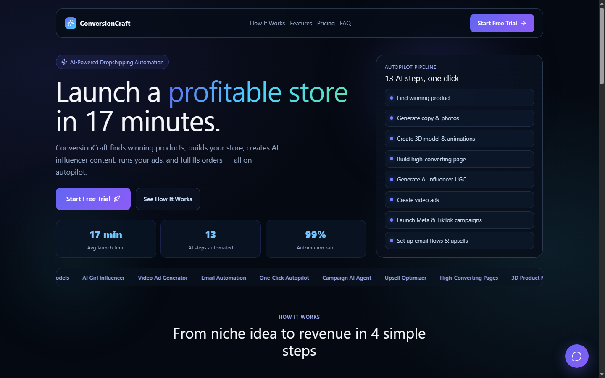
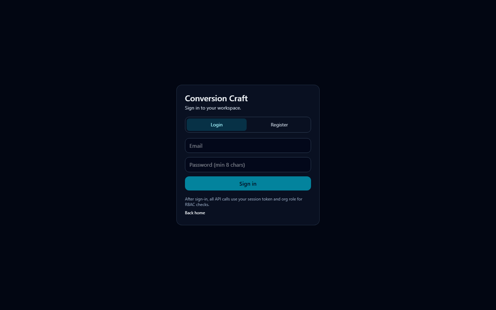
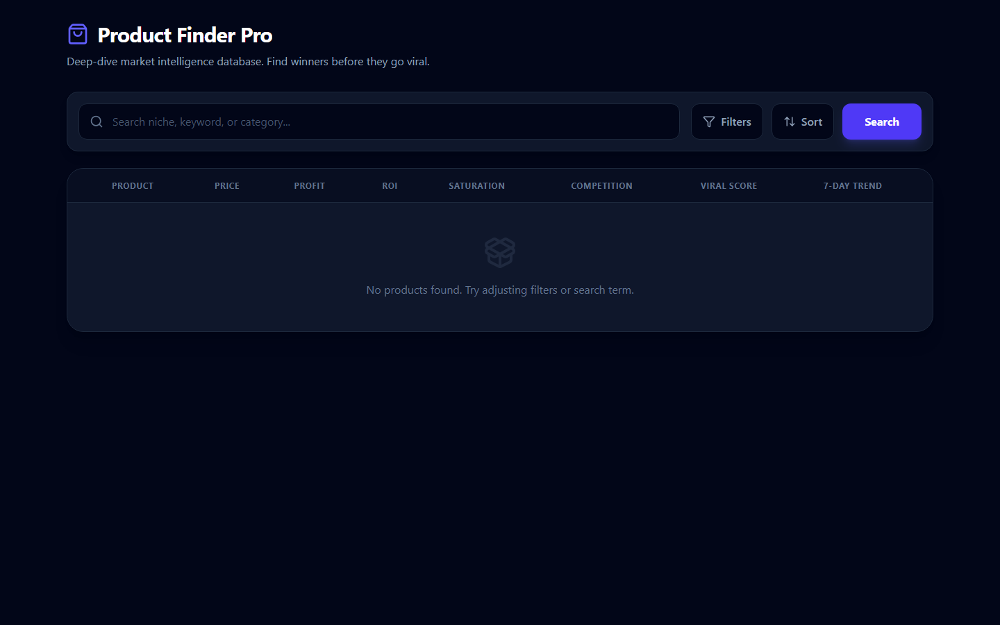
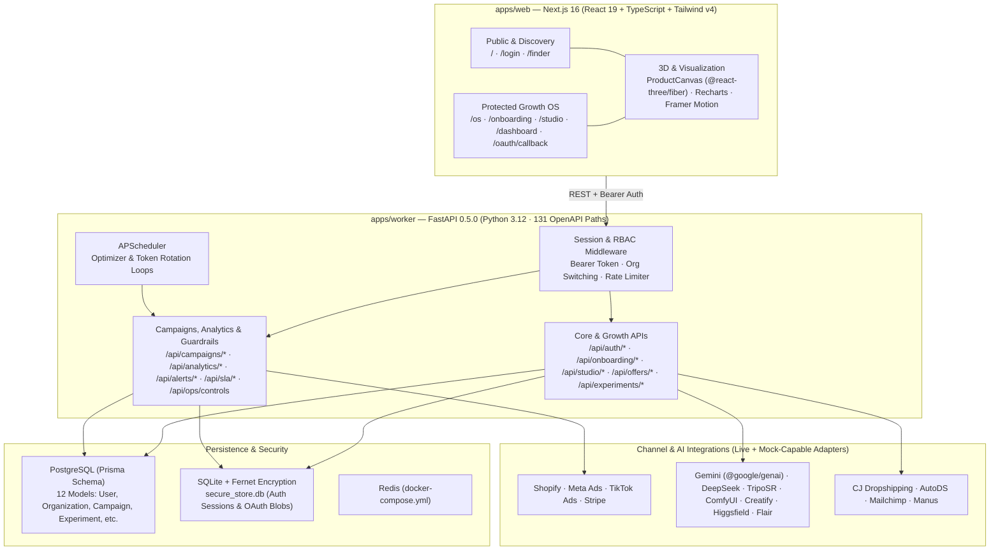

# ConversionCraft

**ConversionCraft** is a full-stack **Growth OS for ecommerce** that unifies product & supplier discovery, AI copywriting and 3D/UGC creative generation, conversion-focused landing page building, multi-channel paid-media execution, and guardrail-enforced revenue optimization in a single monorepo.

> For the full phase-by-phase API contract reference originally shipped with the repo, see [`docs/README_DETAILED.md`](docs/README_DETAILED.md).

---

## Visual Proof (Local Production Build)

Rendered locally from `apps/web` (`next build` + `next start -p 3000`):

| Landing Page (`/`) | Workspace Auth (`/login`) | Product Finder Pro (`/finder`) |
|---|---|---|
|  |  |  |

---

## Architecture



---

## Verified Feature Breakdown & Proof

All checks below were executed directly against this branch (`docs/portfolio-demo`) without private production credentials:

| Area | Command / Source | Observed Result | Notes |
|---|---|---|---|
| **Frontend Typecheck** | `cd apps/web && npx tsc --noEmit` | **PASS** (exit `0`, 0 errors) | Matches CI typecheck gate |
| **Frontend Production Build** | `cd apps/web && npm run build` | **PASS** (exit `0`, compiled in `12.5s`, `11/11` static pages) | Built routes: `/`, `/_not-found`, `/dashboard`, `/finder`, `/login`, `/oauth/callback`, `/onboarding`, `/os`, `/studio` |
| **Frontend Linter** | `cd apps/web && npm run lint` | **23 problems** (`11` errors, `12` warnings) | Unescaped quotes & `any` types in `apps/web/src/app/finder/components/*`, `geminiService.ts`, `types/index.ts` |
| **Worker App Import & OpenAPI** | `python -c "from main import app; print('Import OK')"` | **PASS** (`Import OK`) | FastAPI `ConversionCraft Worker API` `v0.5.0`: **131 paths**, **135 operations** ([`docs/API_SCHEMA_SUMMARY.md`](docs/API_SCHEMA_SUMMARY.md)) |
| **Worker Test Suite** | `pytest tests/ -v --tb=short` | **1 passed, 14 failed** | `test_health` passed (`200`); 14 `/api/*` tests returned `401 Unauthorized` because Phase 8 auth middleware requires a Bearer token not yet sent by `test_health.py` |
| **Database Schema** | `packages/db/schema.prisma` | **12 Prisma models** | `User`, `Organization`, `OrgMember`, `OAuthToken`, `Campaign`, `Experiment`, `AttributionEvent`, `OnboardingState`, `StudioState`, `AuditLog`, `AlertRoute`, `AnalyticsPreferences` |

### Key Capabilities (see [`docs/FEATURE_MATRIX.md`](docs/FEATURE_MATRIX.md) for endpoint-level status)
- **Auth, Orgs & RBAC**: Email/password registration & login, Bearer session tokens, org switching, and Fernet-encrypted `secure_store.db`.
- **Competitor & Product Intelligence**: Niche analysis (`/api/analyze`), CJ Dropshipping & AutoDS sourcing (`/api/sourcing/*`, `/api/fulfillment/*`), and Product Finder Pro UI (`/finder`).
- **Offer Engine & Storefront**: Bundle/upsell recommendations (`/api/offers/recommend-v2`), landing page generation (`/api/store/*`), and interactive 3D product viewer (`ProductCanvas` via `@react-three/fiber`).
- **Creative Studio & AI Media**: Kanban pipeline (`/studio`) with optimistic concurrency versioning (`409` conflict handling) and mock-capable adapters for DeepSeek, TripoSR, Creatify, Higgsfield, Flair, and ComfyUI influencer flows.
- **Revenue Ops, SLA & Kill-Switches**: Enterprise analytics (`/dashboard`), alert routing & escalation policy validation with line-level JSON error hints, MTTA/MTTR SLA tracking, and `/api/ops/controls` execution caps.

---

## Verified Tech Stack

### Root Monorepo (`package.json`) & Infrastructure
- **Monorepo runner**: `concurrently` (`^8.2.2`)
- **Containers**: `docker-compose.yml` (`postgres:15-alpine`, `redis:alpine`)
- **Deployment configs**: `vercel.json` (`@vercel/next`), `render.yaml` (`uvicorn main:app`), `.github/workflows/ci.yml`

### Frontend (`apps/web/package.json`)
- **Framework**: `next` (`16.0.4`), `react` (`19.2.0`), `react-dom` (`19.2.0`), `typescript` (`^5`)
- **UI & Styling**: `tailwindcss` (`^4`), `@tailwindcss/postcss` (`^4`), `tailwindcss-animate` (`^1.0.7`), `tailwind-merge` (`^3.4.0`), `clsx` (`^2.1.1`), `@radix-ui/react-dialog` (`^1.1.15`), `lucide-react` (`^0.554.0`), `framer-motion` (`^12.33.0`)
- **3D & Charts**: `three` (`^0.181.2`), `@react-three/fiber` (`^9.5.0`), `@react-three/drei` (`^10.7.7`), `recharts` (`^3.7.0`)
- **AI & Content**: `@google/genai` (`^1.30.0`), `react-markdown` (`^10.1.0`)
- **Linting**: `eslint` (`^9`), `eslint-config-next` (`16.0.4`)

### Backend Worker (`apps/worker/requirements.txt`)
- **Web & API**: `fastapi`, `uvicorn`, `python-multipart`, `requests`, `python-dotenv`
- **Security & Scheduling**: `cryptography`, `apscheduler`
- **Database**: `prisma`
- **AI & Scraping**: `google-generativeai`, `replicate`, `apify-client`

---

## Local Setup

### Prerequisites
- Node.js 20+ and npm
- Python 3.12+
- Docker (optional, for local PostgreSQL + Redis)

### 1. Environment Variables
```bash
cp apps/worker/.env.example apps/worker/.env
```
*(Configure `DATABASE_URL`, `CORS_ORIGINS`, and optional provider keys in `apps/worker/.env`. All mock-capable endpoints work locally without external paid API keys.)*

### 2. Install & Run
```bash
# Optional: start Postgres + Redis
docker compose up -d

# Root monorepo scripts
npm install

# Frontend
cd apps/web
npm install
npm run dev          # http://localhost:3000

# Backend worker (in a second terminal)
cd apps/worker
python -m venv venv
# Windows: .\venv\Scripts\activate | macOS/Linux: source venv/bin/activate
pip install -r requirements.txt
uvicorn main:app --reload --port 8000
```

---

## Documentation Index

- [`docs/CASE_STUDY.md`](docs/CASE_STUDY.md) — Engineering case study (problem, architecture decisions, trade-offs, and honest gaps)
- [`docs/README_DETAILED.md`](docs/README_DETAILED.md) — Full preserved API contract & phase-by-phase reference
- [`docs/FEATURE_MATRIX.md`](docs/FEATURE_MATRIX.md) — Endpoint-by-endpoint `live` / `mock-capable` / `scaffold` status matrix
- [`docs/API_SCHEMA_SUMMARY.md`](docs/API_SCHEMA_SUMMARY.md) — Machine-generated FastAPI OpenAPI route inventory (131 paths)
