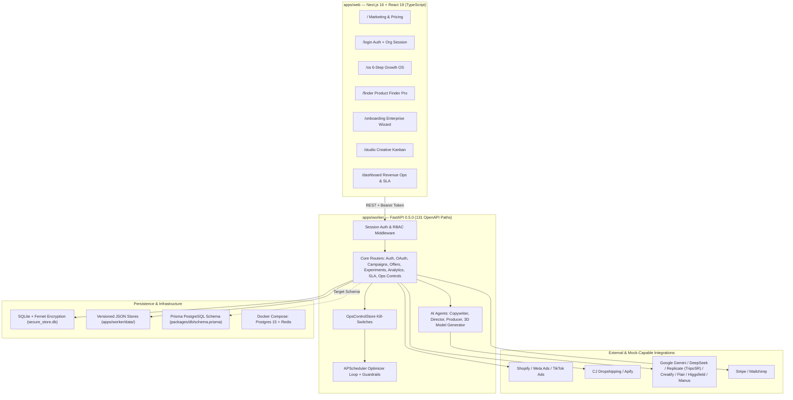

# Conversion Craft

**Conversion Craft** is a full-stack SaaS **Growth OS for ecommerce** that unifies product intelligence, supplier sourcing, offer & landing page generation, creative automation, paid-media execution, and revenue operations in a single monorepo.

> **Case Study & Deep Dive:** Read [docs/CASE_STUDY.md](docs/CASE_STUDY.md) for the engineering story, tradeoffs, and architecture decisions. The original detailed API & phase reference is preserved at [docs/README_DETAILED.md](docs/README_DETAILED.md).

---

## Architecture



---

## Verified Feature Breakdown & Proof

### 1. Channel, Auth & Multi-Org RBAC Layer
- Email/password authentication (`/api/auth/register`, `/api/auth/login`, `/api/auth/session`, `/api/auth/switch-org`, `/api/auth/logout`) backed by SQLite + `cryptography.fernet` encryption (`secure_store.db`).
- Global `/api/*` session middleware (`inject_session_context`) with explicit public allowlist for login/register and signed webhooks.
- OAuth connect/callback scaffolding for Shopify, Meta, and TikTok with state/nonce validation, token rotation hooks, webhook signature verification, and idempotency guards.

### 2. Intelligence & Sourcing Layer
- Niche product discovery (`apps/worker/src/sourcing/finder.py`) with 3x markup profitability calculation, CJ Dropshipping integration, and Apify/mock fallback.
- Competitor site analysis (`/api/analyze`) and Product Finder Pro UI (`/finder`) with filtering, sorting, comparison modal, and score breakdown.

### 3. Conversion, Offer & Experimentation Layer
- Margin- and inventory-constrained Offer Engine (`/api/offers/recommend-v2`) generating pre-checkout bundle blocks and post-purchase upsells.
- Deterministic SHA-256 variant assignment, softmax traffic rebalancing, and z-test significance evaluation (`/api/experiments/*`).
- AI page builder (`/api/store/build-page`, `/api/store/build-landing`) and 3D product viewer (`ProductCanvas.tsx` via Three.js).

### 4. Creative Ops Studio
- Kanban pipeline (`/studio`: `concepts -> variants -> scheduled -> posted`) with optimistic concurrency (`expected_version` -> `409 version_conflict` on stale writes).
- Mock-capable creative service wrappers for DeepSeek copywriting, Google Gemini agents, Replicate/TripoSR 3D, Creatify, Flair, Higgsfield, and Comfy-style influencer workflows.

### 5. Revenue Ops, SLA & Safety Controls
- Automated optimizer loop (`APScheduler` + `OptimizerExecutor`) enforcing per-platform ROAS floors and daily budget increase caps.
- Runtime **Ops Kill-Switches** (`/api/ops/controls`) gating `/api/campaigns/optimizer/execute`, `/api/copilot/execute`, and `/api/autopilot/launch` with per-run action caps.
- Enterprise analytics, anomaly detection, MTTA/MTTR SLA metrics, alert routing, and escalation policy JSON validation with line/column error hints.

---

## Visual & Verification Proof

### Rendered UI Screenshots (Local Next.js Dev Server)
| Landing Page (`/`) | Auth & Workspace Login (`/login`) | Product Finder Pro (`/finder`) |
|---|---|---|
|  |  |  |

### Automated Checks & API Schema
Full observed command outputs are recorded in [docs/VERIFIED_CHECKS.md](docs/VERIFIED_CHECKS.md) and the exported FastAPI schema is at [docs/openapi.json](docs/openapi.json).

- **TypeScript (`npx tsc --noEmit` in `apps/web`):** Passed with `0` errors.
- **FastAPI Worker Import & OpenAPI:** `from main import app` succeeded; exported **131 API paths** to [docs/openapi.json](docs/openapi.json).
- **ESLint (`npm run lint` in `apps/web`):** Reported `23 problems (11 errors, 12 warnings)` (unescaped entities and `no-explicit-any` in finder/service types).
- **Next.js Build (`npm run build` in `apps/web`):** Compiled in `14.3s`, then failed at page data collection (`ENOENT` on `.next/server/pages-manifest.json` with Turbopack workspace root inference).
- **Worker Pytest (`python -m pytest tests/ -v --tb=short`):** `1 passed` (`/health`), `14 failed` (`401 Unauthorized` because `tests/test_health.py` predates the Bearer session auth middleware added in `7b86c8f`).

See [docs/FEATURE_MATRIX.md](docs/FEATURE_MATRIX.md) for the endpoint-by-endpoint `live` / `mock-capable` / `scaffold` matrix.

---

## Verified Tech Stack

### Monorepo Root (`package.json`, `docker-compose.yml`, `render.yaml`, `vercel.json`)
- **Orchestration:** `concurrently` (`^8.2.2`), `docker-compose.yml` (`postgres:15-alpine`, `redis:alpine`)
- **Deployment Targets:** `vercel.json` (`@vercel/next`), `render.yaml` (`conversion-craft-worker` Python web service)

### Frontend (`apps/web/package.json`)
- **Framework:** `next` (`16.0.4`), `react` (`19.2.0`), `react-dom` (`19.2.0`), `typescript` (`^5`)
- **Styling & Animation:** `tailwindcss` (`^4`), `@tailwindcss/postcss` (`^4`), `tailwindcss-animate` (`^1.0.7`), `framer-motion` (`^12.33.0`), `clsx` (`^2.1.1`), `tailwind-merge` (`^3.4.0`)
- **UI, 3D & Data Viz:** `@radix-ui/react-dialog` (`^1.1.15`), `lucide-react` (`^0.554.0`), `recharts` (`^3.7.0`), `three` (`^0.181.2`), `@react-three/fiber` (`^9.5.0`), `@react-three/drei` (`^10.7.7`), `react-markdown` (`^10.1.0`)
- **AI SDK:** `@google/genai` (`^1.30.0`)
- **Linting:** `eslint` (`^9`), `eslint-config-next` (`16.0.4`)

### Backend Worker (`apps/worker/requirements.txt`)
- **Web & Runtime:** `fastapi`, `uvicorn`, `python-multipart`, `python-dotenv`, `requests`
- **Security & Scheduling:** `cryptography`, `apscheduler`
- **AI & External SDKs:** `google-generativeai`, `apify-client`, `replicate`
- **Database Client:** `prisma` (schema in `packages/db/schema.prisma` targeting PostgreSQL)

---

## Local Setup

### Prerequisites
- Node.js 20+ and npm
- Python 3.12+
- (Optional) Docker for Postgres 15 & Redis (`docker compose up -d`)

### 1. Install Dependencies
```bash
# Root
npm install

# Frontend
cd apps/web && npm ci

# Backend Worker
cd ../worker
python -m venv .venv
# Windows: .\.venv\Scripts\activate
# macOS/Linux: source .venv/bin/activate
pip install -r requirements.txt
```

### 2. Configure Environment
```bash
cp apps/web/.env.example apps/web/.env.local
cp apps/worker/.env.example apps/worker/.env
```
Mock-capable endpoints work locally without third-party API keys.

### 3. Run Locally
```bash
# Terminal 1 — FastAPI Worker (:8000)
cd apps/worker
uvicorn main:app --reload --port 8000

# Terminal 2 — Next.js Frontend (:3000)
cd apps/web
npm run dev
```

---

## Repository Map

```text
conversioncraft/
├── apps/
│   ├── web/                  # Next.js 16 Growth OS UI
│   └── worker/               # FastAPI backend + AI agents + APScheduler
├── packages/db/              # Shared Prisma PostgreSQL schema
├── docs/
│   ├── CASE_STUDY.md         # First-person engineering case study
│   ├── README_DETAILED.md    # Preserved full API & phase reference
│   ├── FEATURE_MATRIX.md     # Route & endpoint status matrix
│   ├── VERIFIED_CHECKS.md    # Observed test/lint/build outputs
│   ├── openapi.json          # Exported FastAPI OpenAPI schema (131 paths)
│   └── screenshots/          # Captured local UI renders
├── legacy/                   # Archived legacy assets (non-primary runtime)
├── docker-compose.yml
├── render.yaml
└── vercel.json
```
