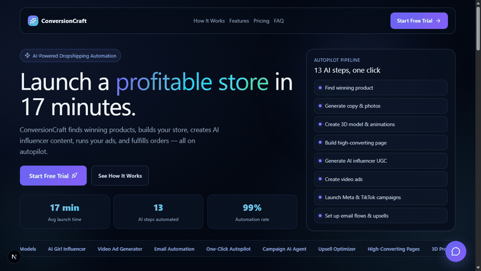
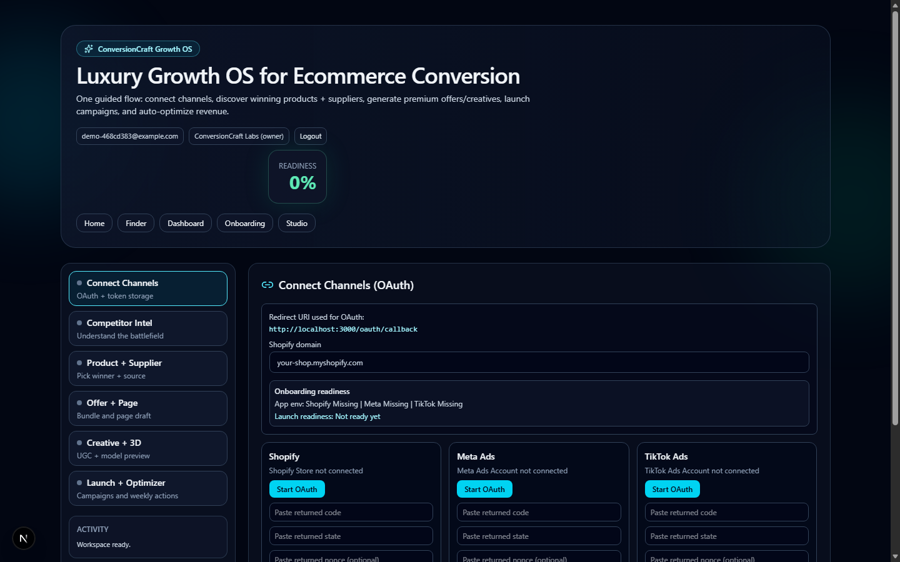
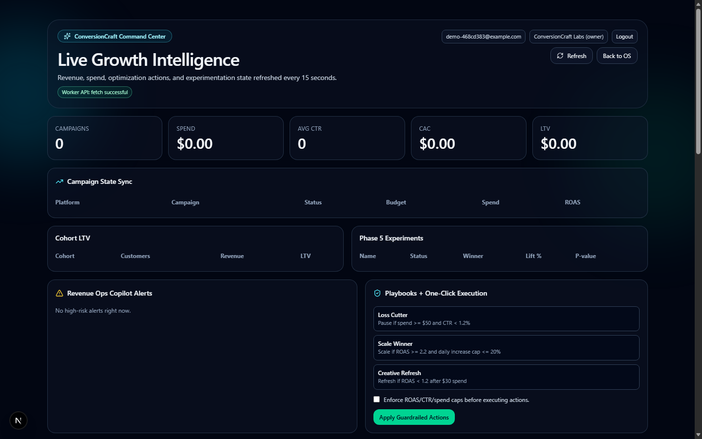
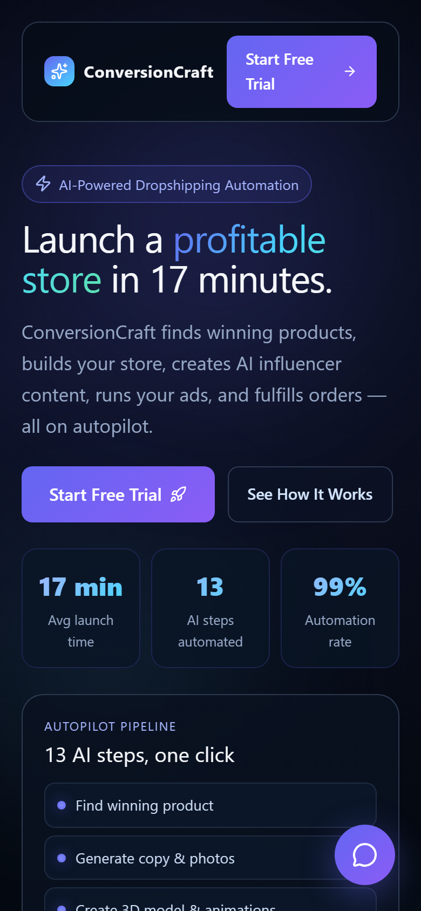
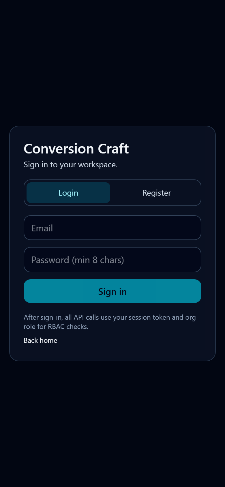
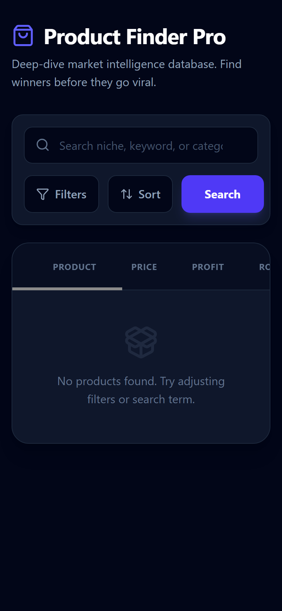
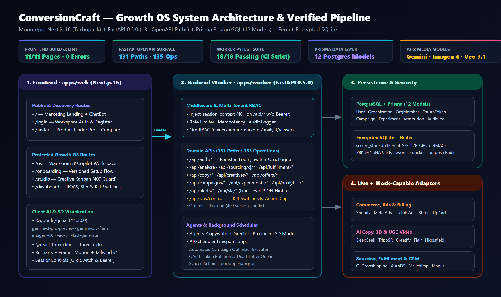
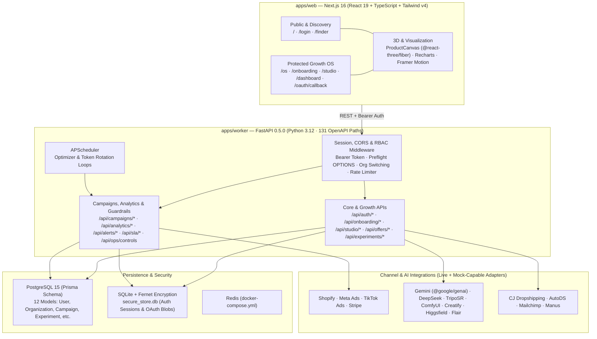

# ConversionCraft

**ConversionCraft** is a full-stack **Growth OS for ecommerce** that unifies product & supplier discovery, AI copywriting and 3D/UGC creative generation, conversion-focused landing page building, multi-channel paid-media execution, and guardrail-enforced revenue optimization in a single monorepo.

> For the full phase-by-phase API contract reference originally shipped with the repo, see [`docs/README_DETAILED.md`](docs/README_DETAILED.md).

---

## Visual Proof & Live Walkthrough

### Interactive Walkthrough (Next.js 16 + Live FastAPI Worker)

Recorded via headless Chromium/Edge (Chrome DevTools Protocol) + FFmpeg walking through `/`, `/login` (live account registration against FastAPI `/api/auth/register`), `/os`, `/studio`, `/dashboard`, and `/finder`:



- Full HD Video: [`docs/images/walkthrough.mp4`](docs/images/walkthrough.mp4) (`484 KB`) · [`docs/images/walkthrough.webm`](docs/images/walkthrough.webm) (`1.03 MB`)

### Desktop Views (`1440×900`)

| Landing Page (`/`) | Workspace Auth (`/login`) | Product Finder Pro (`/finder`) |
|---|---|---|
|  |  |  |

| Growth OS War Room (`/os`, Authenticated) | Command Center & Guardrails (`/dashboard`, Authenticated) |
|---|---|
|  |  |

### Mobile Views (`390×844`)

| Mobile Landing (`/`) | Mobile Auth (`/login`) | Mobile Finder (`/finder`) |
|---|---|---|
|  |  |  |

---

## Architecture





---

## Tools, Skills, AI Models & Engineering Stack

Every tool, model, and library listed below is directly verified in the repository source and dependency manifests:

### AI Models & Generative Media Pipelines
- **Google Gemini SDK (`@google/genai` `^1.30.0` in `apps/web/src/services/geminiService.ts`)**:
  - `gemini-3-pro-preview` (with `googleSearch` grounding and `thinkingBudget`): niche product discovery, competitor battlefield analysis, Meta/TikTok ad library research, supplier matching, review synthesis, market simulation, trend genesis, and arbitrage opportunity scanning.
  - `gemini-2.5-flash` & `gemini-2.5-flash-image`: fast social caption generation, landing-page assistant chat, and image-to-image marketing creative editing (`Modality.IMAGE`).
  - `imagen-4.0-generate-001`: commercial product mockup and studio photography generation.
  - `veo-3.1-fast-generate-preview`: short-form product video and ad scene generation.
- **Worker AI Agents (`google-generativeai` in `apps/worker/src/agents/`)**:
  - `copywriter.py` and `director.py` invoke `gemini-1.5-pro-latest` for server-side copywriting and storyboard generation; `producer.py` and `model_generator.py` orchestrate Replicate (`replicate`) and 3D model pipelines.
- **DeepSeek (`apps/worker/src/services/deepseek_service.py` & `chatbot_service.py`)**: OpenAI-compatible `api.deepseek.com/v1` adapter for product descriptions, ad copy, SEO content, and the landing-page concierge chatbot (with deterministic template fallbacks when unconfigured).
- **Specialized Creative & Sourcing Adapters (`apps/worker/src/services/`)**: Mock-capable wrappers for `creatify_service.py` (AI UGC video), `flair_service.py` (product staging & background removal), `triposr_service.py` (3D mesh synthesis), `higgsfield_service.py`, `cj_service.py` (CJ Dropshipping), `autods_service.py` (AutoDS fulfillment), `mailchimp_service.py`, `manus_service.py`, `upcart_service.py`, and `stripe_service.py`.

### Frontend Application (`apps/web/package.json`)
- **Framework & Language**: `next` (`16.0.4`, App Router + Turbopack with scoped `turbopack.root`), `react` (`19.2.0`), `react-dom` (`19.2.0`), `typescript` (`^5`).
- **UI, Motion & Styling**: `tailwindcss` (`^4`), `@tailwindcss/postcss` (`^4`), `tailwindcss-animate` (`^1.0.7`), `tailwind-merge` (`^3.4.0`), `clsx` (`^2.1.1`), `@radix-ui/react-dialog` (`^1.1.15`), `lucide-react` (`^0.554.0`), `framer-motion` (`^12.33.0`), `react-markdown` (`^10.1.0`).
- **3D & Analytics Visualization**: `three` (`^0.181.2`), `@react-three/fiber` (`^9.5.0`), `@react-three/drei` (`^10.7.7`) powering `ProductCanvas`, plus `recharts` (`^3.7.0`) for trend and performance charts.
- **Code Quality**: `eslint` (`^9`) + `eslint-config-next` (`16.0.4`).

### Backend Worker, API Contract & Security (`apps/worker`)
- **API & Runtime**: `fastapi` (`ConversionCraft Worker API v0.5.0`), `uvicorn`, `pydantic`, `python-multipart`, `requests`, `python-dotenv`.
- **OpenAPI Contract**: Machine-verified `131` OpenAPI paths (`135` operations) exported in [`docs/openapi.json`](docs/openapi.json) and summarized in [`docs/API_SCHEMA_SUMMARY.md`](docs/API_SCHEMA_SUMMARY.md).
- **Auth, Encryption & Multi-Tenant RBAC**: `AuthService` (`apps/worker/src/services/auth_service.py`) persists users and Bearer sessions in SQLite (`secure_store.db`), hashes passwords with `PBKDF2-SHA256` (210,000 iterations), and encrypts session/OAuth payloads with `cryptography.fernet.Fernet`. `inject_session_context` middleware enforces Bearer auth across `/api/*` while passing `OPTIONS` CORS preflights to `CORSMiddleware`.
- **Reliability & Scheduling**: `apscheduler` for background optimizer execution and OAuth token rotation, paired with `rate_limiter.py`, `idempotency_store.py`, `dead_letter_queue.py`, `audit_logger.py`, optimistic concurrency (`409` `version_conflict`), and `/api/ops/controls` kill-switches.

### Database, Infrastructure & QA Tooling
- **Database & Cache**: `prisma` + `packages/db/schema.prisma` (**12 PostgreSQL models**), `docker-compose.yml` (`postgres:15-alpine`, `redis:alpine`).
- **CI & Verification**: `.github/workflows/ci.yml` enforcing `npx tsc --noEmit`, `npm run lint`, `npm run build`, FastAPI import check, and `pytest tests/ -v --tb=short`; headless Chromium/Edge via Chrome DevTools Protocol (CDP) + FFmpeg for desktop (`1440×900`) and mobile (`390×844`) screenshot and walkthrough video capture.
- **Monorepo & Deployment**: `concurrently` (`^8.2.2`), `vercel.json` (`@vercel/next`), `render.yaml` (`uvicorn main:app`).

---

## Verified Feature Breakdown & Proof

All checks below were executed directly against this branch (`docs/portfolio-demo`) without private production credentials:

| Area | Command / Source | Observed Result | Notes |
|---|---|---|---|
| **Frontend Typecheck** | `cd apps/web && npx tsc --noEmit` | **PASS** (`exit 0`, `0` errors) | Strict TypeScript check across all `.ts`/`.tsx` files |
| **Frontend Linter** | `cd apps/web && npm run lint` | **PASS** (`exit 0`, `0` errors) | `3` `@next/next/no-img-element` warnings for dynamic external supplier images |
| **Frontend Production Build** | `cd apps/web && npm run build` | **PASS** (`exit 0`, `10.6s` compile, `11/11` static pages) | Built `/`, `/_not-found`, `/dashboard`, `/finder`, `/login`, `/oauth/callback`, `/onboarding`, `/os`, `/studio` |
| **Worker App Import & OpenAPI** | `python -c "from main import app; print('Import OK')"` | **PASS** (`Import OK`) | FastAPI `ConversionCraft Worker API` `v0.5.0`: **131 paths**, **135 operations**, [`docs/openapi.json`](docs/openapi.json) synced |
| **Worker Test Suite** | `pytest tests/ -v --tb=short` | **18 passed, 0 failed** (`6.34s`) | Covers `/health`, unauthenticated `401`, CORS `OPTIONS` preflight, auth register/login/session/logout lifecycle, and all 14 `/api/*` endpoints |
| **Database Schema** | `packages/db/schema.prisma` | **12 Prisma models** | `User`, `Organization`, `OrgMember`, `OAuthToken`, `Campaign`, `Experiment`, `AttributionEvent`, `OnboardingState`, `StudioState`, `AuditLog`, `AlertRoute`, `AnalyticsPreferences` |

---

## Local Setup

### Prerequisites
- Node.js 20+ and npm
- Python 3.12+
- Docker (optional, for local PostgreSQL + Redis)

### 1. Environment Variables
```bash
cp apps/worker/.env.example apps/worker/.env
```
*(Configure `DATABASE_URL`, `CORS_ORIGINS`, and optional provider keys in `apps/worker/.env`. All mock-capable endpoints work locally without external paid API keys.)*

### 2. Install & Run
```bash
# Optional: start Postgres + Redis
docker compose up -d

# Root monorepo scripts
npm install

# Frontend
cd apps/web
npm install
npm run dev          # http://localhost:3000

# Backend worker (in a second terminal)
cd apps/worker
python -m venv venv
# Windows: .\venv\Scripts\activate | macOS/Linux: source venv/bin/activate
pip install -r requirements.txt
uvicorn main:app --reload --port 8000
```

---

## Documentation Index

- [`docs/CASE_STUDY.md`](docs/CASE_STUDY.md) — Engineering case study (problem, architecture decisions, security/CORS fixes, and honest gaps)
- [`docs/PROOF_OF_WORK.md`](docs/PROOF_OF_WORK.md) — Full post-edit verification log, command outputs, and visual artifact inventory
- [`docs/VERIFIED_CHECKS.md`](docs/VERIFIED_CHECKS.md) — Concise check matrix and observed command transcripts
- [`docs/README_DETAILED.md`](docs/README_DETAILED.md) — Full preserved API contract & phase-by-phase reference
- [`docs/FEATURE_MATRIX.md`](docs/FEATURE_MATRIX.md) — Endpoint-by-endpoint `live` / `mock-capable` / `scaffold` status matrix
- [`docs/API_SCHEMA_SUMMARY.md`](docs/API_SCHEMA_SUMMARY.md) — Machine-generated FastAPI OpenAPI route inventory (131 paths)
